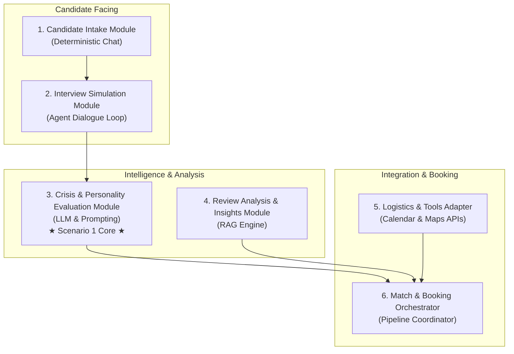
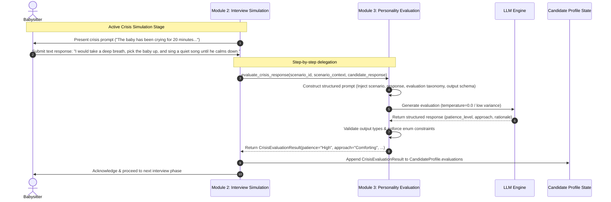
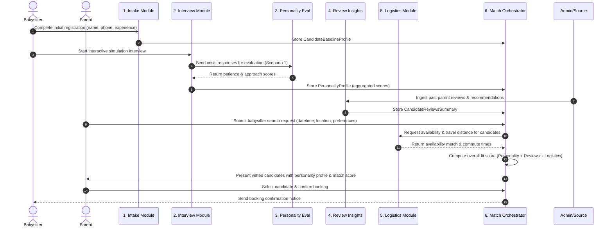

# AI Babysitter MVP: Modular Architecture Design

## 1. Overview & Architectural Principles

The AI Babysitter MVP is designed following the **Single Responsibility Principle (SRP)** and **Separation of Concerns (SoC)**. Each module encapsulates one cohesive business domain or technical capability, enabling independent testing, straightforward mocking, and maintainable evolution from the MVP to the grand vision.

---

## 2. Module Breakdown

### Module 1: Candidate Intake Module (`candidate_intake`)
- **Single Responsibility:** Collect, validate, and record candidate baseline information (name, age, contact details, basic experience, certifications) through a deterministic onboarding flow.
- **Underlying Technique:** Ordinary code (rule-based state machine / form wizard, non-AI).
- **Input:** Raw user chat inputs or web form submissions.
- **Output:** Validated `CandidateBaselineProfile` (ID, personal info, verified phone, basic attributes).
- **Used in Scenario 1:** **No** (Scenario 1 focuses specifically on crisis scenario evaluation).

---

### Module 2: Interview Simulation Module (`interview_simulation`)
- **Single Responsibility:** Orchestrate interactive multi-turn interview conversations, introducing childcare stress scenarios (e.g., crying baby, tantrums) and tracking interview progression.
- **Underlying Technique:** Agent loop, multi-turn conversation state manager.
- **Input:** Candidate ID, selected crisis simulation scenario, candidate conversational messages.
- **Output:** `InterviewSessionState`, scenario delivery events, candidate response payloads, and full interview transcript.
- **Used in Scenario 1:** **Yes (Context Provider / Caller)** — provides the simulation scenario context and relays the babysitter's response to the evaluation module.

---

### Module 3: Crisis & Personality Evaluation Module (`personality_evaluation`)
- **Single Responsibility:** Analyze candidate answers to childcare crisis scenarios to evaluate psychological traits—specifically **patience level** and **primary educational approach**—and generate structured assessment metrics.
- **Underlying Technique:** LLM Call with structured prompt engineering and constrained output validation (JSON schema / enum classification).
- **Input:** 
  - Scenario description & context (e.g., "Baby won't stop crying after feeding").
  - Babysitter's verbatim response text.
- **Output:** `CrisisEvaluationResult` containing:
  - `patience_level`: `High` | `Medium` | `Low`
  - `approach`: `Comforting` | `Strict / Independent` | `Distraction` | (extensible taxonomy)
  - `rationale`: Concise explanatory justification based on the response.
- **Used in Scenario 1:** **Yes (Core Module)** — this module directly performs the evaluation required by Scenario 1.

---

### Module 4: Review Analysis & Insights Module (`review_insights`)
- **Single Responsibility:** Ingest, index, and retrieve unstructured recommendations and past feedback (e.g., WhatsApp messages, social recommendations) to extract reliability and performance summaries.
- **Underlying Technique:** RAG (Retrieval-Augmented Generation) — text embedding, semantic retrieval, and LLM synthesis.
- **Input:** Unstructured review texts, candidate ID, query criteria.
- **Output:** `CandidateReviewsSummary` (verified strengths, recurring feedback themes, sentiment score, reference quotes).
- **Used in Scenario 1:** **No** (Used during comprehensive candidate vetting, not in single crisis response evaluation).

---

### Module 5: Logistics & Tools Adapter (`logistics_tools`)
- **Single Responsibility:** Interface with external operational systems to verify calendar availability and calculate travel distances between parents and babysitters.
- **Underlying Technique:** Tool calling / external API wrappers (Calendar API, Maps / Geolocation API).
- **Input:** Candidate availability schedule, parent required time slot, parent location coordinates, candidate origin coordinates.
- **Output:** `LogisticsAssessment` (availability match status, commute distance in km, estimated travel time in minutes).
- **Used in Scenario 1:** **No** (Logistical checks happen independently of psychological response evaluation).

---

### Module 6: Match & Booking Orchestrator (`match_orchestrator`)
- **Single Responsibility:** Aggregate personality profiles, review insights, and logistics data to score candidate suitability for a parent's request and manage the final booking confirmation.
- **Underlying Technique:** Decision logic & summary synthesis.
- **Input:** Aggregated candidate profile (`CandidateBaselineProfile` + `PersonalityProfile` + `ReviewSummary` + `LogisticsAssessment`) and `ParentBookingRequest`.
- **Output:** Ranked candidate match recommendation, booking status notification.
- **Used in Scenario 1:** **No** (Operates at the final synthesis and booking stage).

---

## 3. Module Participation Matrix

| Module | Core Responsibility | Technique | Used in Scenario 1? |
|---|---|---|:---:|
| **1. Candidate Intake** | Collect basic candidate demographic details | Deterministic code | No |
| **2. Interview Simulation** | Drive multi-turn scenario dialogue | Agent loop | **Yes** (Caller / Context) |
| **3. Personality Evaluation** | Evaluate crisis responses (patience & approach) | LLM & Structured Prompting | **Yes (Primary Focus)** |
| **4. Review Insights (RAG)** | Extract insights from past testimonials | RAG | No |
| **5. Logistics & Tools** | Check availability & calculate travel distance | External API Tool Calling | No |
| **6. Match & Booking** | Synthesize candidate profile & finalize booking | Orchestration logic | No |

---

## 4. Step-by-Step Information Flow: Scenario 1

**Scenario 1 Context:**  
The AI agent receives a babysitter's text response to a stressful childcare scenario (e.g., baby won't stop crying) and evaluates her patience level and primary educational approach.

### Sequence Diagram

### Detailed Step-by-Step Walkthrough

1. **Prompt Delivery & User Response:**  
   The `Interview Simulation Module` maintains the active interview session. It delivers a crisis prompt to the babysitter:  
   *Context:* "You fed and changed the 6-month-old baby, but he has been crying inconsolably for 20 minutes. What do you do?"  
   The babysitter sends their raw response string (e.g., *"I would take a deep breath, pick the baby up, and sing a quiet song until he calms down."*).

2. **Payload Packaging & Dispatch:**  
   The `Interview Simulation Module` packages an `EvaluationRequest` containing:
   - `scenario_id`: `"crisis_crying_baby_01"`
   - `scenario_context`: `"Inconsolable crying infant after basic physical needs are met."`
   - `candidate_response`: Raw string from babysitter.  
   It invokes the `Personality Evaluation Module`.

3. **Prompt Composition:**  
   The `Personality Evaluation Module` isolates the evaluation logic. It injects the context and response into a specialized assessment prompt template containing:
   - Clear classification rubrics for **Patience Level** (`High`, `Medium`, `Low`).
   - Classification taxonomy for **Educational Approach** (`Comforting`, `Strict / Independent`, `Distraction`, etc.).
   - Strict output schema requiring valid JSON.

4. **Inference Execution:**  
   The module dispatches the formatted payload to the LLM backend with low sampling temperature for deterministic and consistent classification.

5. **Schema Validation & Parsing:**  
   The `Personality Evaluation Module` parses the LLM output:
   - Validates that `patience_level` is exactly one of the allowed categories (`High`, `Medium`, `Low`).
   - Validates that `approach` matches the recognized approach taxonomy.
   - Extracts the explanation/rationale.
   - Handles errors or triggers a structured retry if the LLM output deviates from the schema.

6. **State Persistence & Propagation:**  
   The validated `CrisisEvaluationResult` is returned to the `Interview Simulation Module`, which attaches it to the candidate's cumulative assessment record in the candidate session store.

---

## 5. End-to-End MVP Information Flow

When all modules operate together in the full MVP lifecycle:

---

## 6. Design Highlights & Rationale

1. **Decoupled Evaluation from Conversation Flow:**  
   Module 3 (`personality_evaluation`) has no direct dependency on UI or chat sockets. It operates as a pure evaluation service (functional input $\rightarrow$ validated output), making it directly unit-testable against the test cases defined in `scenarios.md`.
2. **Deterministic Onboarding vs. Agentic Interview:**  
   Basic candidate intake (Module 1) is kept separate from LLM-driven conversation (Module 2). This avoids token waste on basic form filling and guarantees 100% data integrity for essential fields (phone number, age).
3. **Pluggable Tools & RAG:**  
   External APIs (Google Maps, Calendar) and vector retrieval for reviews are isolated in their own adapters (Modules 4 and 5), allowing the core interview and evaluation flow (Scenario 1) to be tested without active third-party API credentials.
